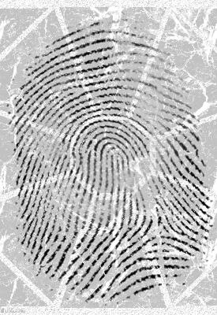
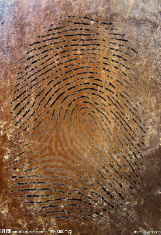
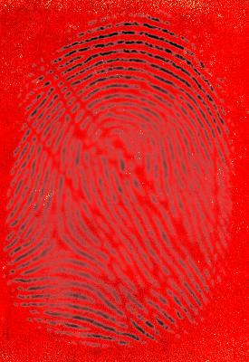
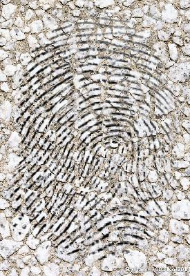
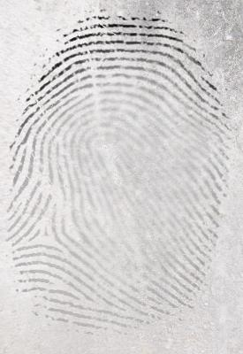
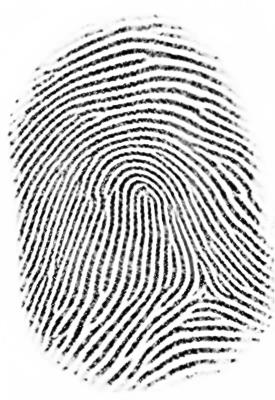
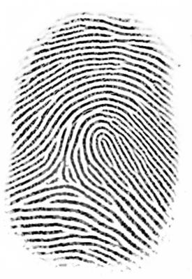
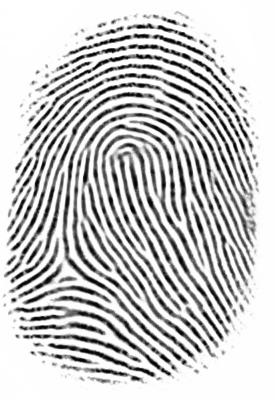
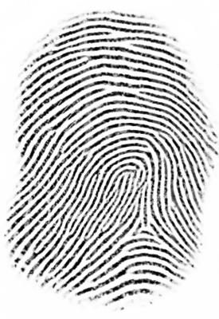
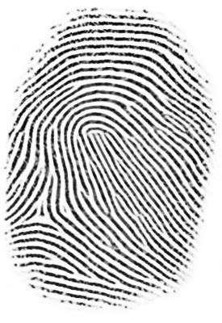

# FPD-M-net: Fingerprint Image Denoising and Inpainting (Keras)

This is end-to-end trainable Convolutional Neural Network (CNN) based architecture for fingerprint image denoising and inpainting problem. We pose the fingerprint denoising and inpainting as a segmentation (foreground) task. Our architecture is based on the _M-net_ which was proposed for brain segmentation. We modify this architecture and call the resulting architecture as **_FPD-M-net_**. The fingerprint images are degraded with varies distortion (blur, brightness, contrast, elastic transformation, occlusion, scratch, resolution, rotation and overlaying the fingerprints on top of various backgrounds). Our model tackles the distortions and noise using encoder layers and restores the fingerprint images using decoder layers. Our method achieves overall _3rd rank_ in the _Chalearn LAP Inpainting Competition Track 3 - Fingerprint Denoising and Inpainting, ECCV 2018_ : http://chalearnlap.cvc.uab.es/dataset/32/results/63/

Paper link : [[FPD-M-net]](https://arxiv.org/abs/1812.10191)

### Dependencies
This code depends on the following libraries:

Keras>=2.0

theano or tensorflow

Also, this code should be compatible with Python versions 2.7-3.5. (tested in python2.7)


### Example
if Cuda enabled
```
CUDA_VISIBLE_DEVICES=0 python2.7 test.py "test_path"
```
else
```
python2.7 test.py "test_path"
```

The predicted results will be in "test_path/Results"

## Results

|  | 1 | 2 | 3 | 4 | 5 |
| :-: | :-: | :-: | :-: | :-: | :-: |
| **I<br>N<br>P<br>U<br>T** |  |  |  |  |  |
| **R<br>E<br>S<br>U<br>L<br>T** |  |  |  |  |  |

### Citation
If you use this code for your research, please cite:

```
@inproceedings{adiga2018fpdmnet,
  title={FPD-M-net: Fingerprint Image Denoising and Inpainting Using M-Net Based Convolutional Neural Networks},
  author={Adiga, Sukesh V and Sivaswamy, Jayanthi},
  booktitle={Fingerprint Inpainting and Denoising Challenges, ECCV workshop},
  pages={51--61},
  year={2018},
  publisher={Springer}
}
```

#### License
This project is licensed under the terms of the MIT license.
